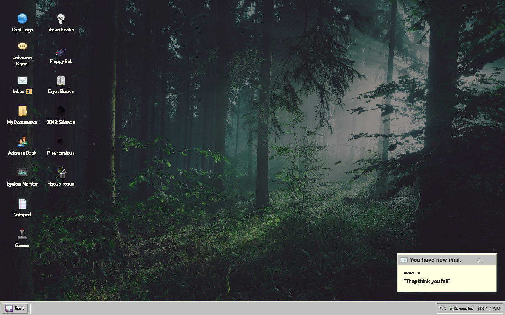

# DEADNET — Room 317

Nora Vale was found dead in room 317. The police called it an accident. Her computer is still answering.

Explore Nora’s recovered PC: read the residents’ messages, inspect a door log, listen to her last call, and show evidence to the unknown contact in Messenger. Her memory comes back in fragments. The person responsible is still using the same network.



**[▶ Play it online](https://room317.onrender.com)** (live open-weight AI, one private case per visitor) · [Scripted exhibition](https://sea-deep.github.io/deadnet/) · [Submission article](docs/SUBMISSION.md) · [Verification](docs/VERIFICATION.md) · [Credits](docs/CREDITS.md)

**The online version on Render** runs live replies from free open-weight models through OpenRouter, gives every browser its own private world, and offers scripted replies in one click if the free pool is busy. Deploy your own with [`render.yaml`](render.yaml). **The GitHub Pages exhibition is clearly scripted.** The full Node app uses your server-side OpenRouter key for live open-weight replies, or Gemma running locally through Ollama. Failed live requests never become scripted dialogue automatically.

## Run

Node 22.13+ and npm are required. Tested on an Apple M5 / 16 GiB Mac.

```sh
git clone https://github.com/sea-deep/deadnet.git
cd deadnet
npm ci
cp .env.example .env
npm run dev
```

Open http://127.0.0.1:3000 and press **Power on**. A **Read Me** window explains the case and how to play on the first visit (it stays on the desktop afterwards).

**No key? It still works.** With no `OPENROUTER_API_KEY` and no Ollama running, the app says no AI model is connected and offers **Use scripted replies**. One click and the whole case is playable with authored responses, clearly labelled as scripted.

For live AI replies, add `OPENROUTER_API_KEY` to `.env` for hosted inference. `MODEL_PROVIDER=auto` selects it when present. The default `OPENROUTER_MODEL=openrouter/free` uses [OpenRouter’s free-only router](https://openrouter.ai/docs/guides/routing/routers/free-router); the actual selected model is recorded in each trace. A real current-case response used `dots-studio/dots-3-note-preview:free`, took 13.820 s, and reported $0. No paid model IDs or paid fallback are enabled. Free capacity and latency can vary.

For local Gemma, run `ollama serve`, pull `gemma4:e2b-it-q4_K_M`, and set `MODEL_PROVIDER=ollama`. The explicitly measured Q4_K_M package is about 4.6 GB; no weights ship in Git. A local compatible adapter is also implemented but not independently benchmarked.

You can also switch between live and scripted replies at any time in System Monitor (**Deterministic baseline (scripted)**). The dev server reloads backend code and `.env`. For production locally: `npm run build && npm start`.

## The computer

**Unknown Signal** is Nora’s private messenger window. Ask what she remembers; attach a file you have opened. The model gets only her memory fragment and records she has actually been shown. She cannot contact the other accounts or broadcast. Ordinary autonomous turns exclude her. After the right case report, the signal closes.

**Chat Logs**, **Inbox**, **My Documents**, **Trash Bin**, **Address Book** and **Notepad** contain the other side of the investigation: Mara’s grief, Len’s disputed alibi, Owen’s management statements, Adam Moore’s case notes (deleted by the SYSOP account, waiting in the Trash Bin) and Nora’s unfinished scraps. The report records the suspect you choose; a wrong accusation has a different final signal. These are fictional characters, not replicas of real deceased people.

All six games have direct desktop shortcuts: **Grave Snake**, **Flappy Bat**, **Crypt Blocks**, **2048: Séance**, **Phantomicus**, and **Hocus :focus**. They adapt existing MIT projects, with visible author credits, shared dark controls, restart/pause/sound options, and keyboard buttons. Flappy uses a sourced animated bat and forest photograph rather than the bright bird/pipe skin. Games pause when another app takes focus. They are part of the case: Nora's game saves share CASE_14.BAK's damaged sectors, so playing any two of them for 20 seconds each (plus opening the two other files) repairs it. The games themselves are adapted, not claimed original AI work.

The BIOS startup, frozen 03:17 clock, forest wallpaper, quiet CC0 ambience, disk/line sounds and recovered call carry the atmosphere. Progress autosaves in the browser and comes back on its own if the server's copy is lost; Start has **Save game**, **Save to floppy…** (a `ROOM317.SAV` file), **Load game…** and **Start over…**. Sound begins after the power gesture; tray mute persists and reaches game/voice audio. Hidden tabs pause ambience. Reduced motion lives in Start. Windows drag, resize, minimize and maximize; small screens use single-tap shortcuts and one maximized window. No flashing overlays.

## Voice

Set `ELEVENLABS_API_KEY`, a licensed `ELEVENLABS_VOICE_ID`, and `ELEVENLABS_MODEL` in `.env`. The verified revision uses the premade **Lily — Velvety Actress** voice and `eleven_v3_conversational`, hushed/rushed delivery, speed 1.14 and stability 0.5. This replaces the earlier broadcaster monologue.

Opening **OCT31_CHAT.TXT** restores **NORA_0314.WAV**. Play it in Inbox or read the transcript. It is a 150-character authored outgoing call, not dynamically invented testimony. One actual render took 1.927 s; the clip is 11.84 s. Cached replay returned identical bytes without another generation. Perceived naturalness has not been independently rated. [Actual evidence](docs/evidence/elevenlabs-case.json).

The cache key includes transcript, voice, model and delivery settings. Ten fresh renders maximum per installation, 900 characters per request; failures preserve text access. No credential or generated voice recording is committed.

## Engine and limits

SQLite atomically stores the world and revision. Three resident accounts can interpret evidence, remember, change bounded trust and pass known facts onward. Nora has a fourth, private state. Twelve memories per account are stored, eight enter context, and three exact visitor disclosures support recall. Objective evidence stays separate from subjective beliefs.

One generation runs at a time. Local Gemma uses 4096 context / 320 output tokens. Hosted thinking routes have a bounded 4096 total output-token allowance with a requested 1024 reasoning budget; Gemma routes request thinking off and 320 output tokens. Text remains schema-limited. Requests have a 45-second timeout and at most two attempts. Eighteen story turns require explicit renewal; optional autonomous turns run once per 35 seconds while a visitor is connected. No unattended catch-up.

Persistent hosted caps: **2 requests/minute and 8/day per local visitor; 5/minute and 30/day shared**, counted per HTTP attempt. Provider 429s persist a cooldown of at least 60 seconds. World reset and story migration do not reset these limits. Days reset at 00:00 UTC. These are installation limits, not multi-tenant authentication.

The model has no shell, filesystem, browser or external messaging tools. Actor-specific local decoding schemas and server validation reject invented evidence IDs/recipients. Text can still repeat, hallucinate or confuse speakers. The objective case and final signal are authored; AI changes the conversations and disclosure path.

## Verification

```sh
npm test                       # 20 engine/audio/quota/provider/hosting tests
npm run build
npm run demo:build              # explicitly scripted static exhibition
npx playwright install chrome
npm run test:e2e                # 6 desktop/mobile investigation/shell/signal tests
npm run games:build             # reproducible credited game adaptations
npx tsx scripts/check-games.ts  # local server required
npx tsx scripts/check-sound.ts
npm run benchmark              # explicit real local inference, no CI model download
```

[Verification](docs/VERIFICATION.md) distinguishes current murder-case checks from the earlier prototype’s nine-request benchmark and five-minute session. Current live evidence: [OpenRouter](docs/evidence/case-openrouter.json), [local Gemma](docs/evidence/case-local-gemma-current.json), [voice](docs/evidence/elevenlabs-case.json). CI uses no model or provider key.

Run locally, the app is **single-user and loopback-only**. `.data/deadnet.sqlite` contains private messages, quotas and cached audio; exports may include what you wrote. Previous prototype worlds are archived in ignored `.data/pre-case-*.json` when this scenario replaces them. The public Pages exhibition uses browser storage and scripted responses. The Render deployment (`DEADNET_PUBLIC=1`) keeps one private world per visitor cookie and pauses all unattended turns.

Code is MIT; all borrowed code/media retain their own licenses. [Third-party modifications](docs/THIRD-PARTY.md) · [actual interface references](docs/research/VISUAL-REFERENCES.md) · [judge audit](docs/JUDGE-AUDIT.md).

Started October 29, 2026, with AI coding assistance. The [DEV article](docs/SUBMISSION.md) remains unpublished pending entrant approval. Deadline: October 31, 23:59 PDT / November 1, 12:29 IST. No demo video is included.
