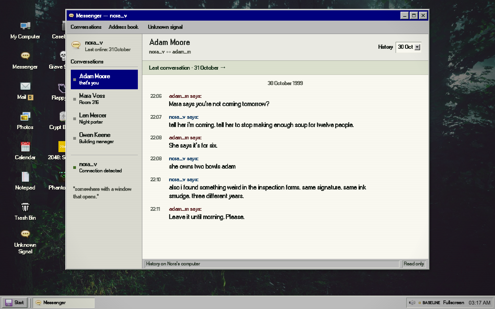

# DEADNET — Room 317

Mara gives you her dead friend’s computer. You are Adam Moore. The last message Nora sent was to you.

Insert your recovery USB, turn on the computer, and look through Nora’s Messenger, mail, photos and calendar. Get to know the person who lived here. When her account signs in again, show her what you find. Her memory is uncertain; the things she left behind can contradict it.



[Play online](https://room317.onrender.com) · [Source](https://github.com/sea-deep/deadnet) · [Scripted static exhibition](https://sea-deep.github.io/deadnet/) · [Credits and licenses](docs/CREDITS.md)

## Run

Node 22.13+ and npm:

```sh
npm ci
cp .env.example .env
npm run dev
```

Open http://127.0.0.1:3000. Insert the USB, then power on. The computer fills the browser; the tray also offers browser fullscreen. Windows drag, resize, minimize and maximize. On phones, a single tap opens an app and each window fills the available space.

For live dialogue, add `OPENROUTER_API_KEY` to the server’s `.env`. `MODEL_PROVIDER=auto` chooses OpenRouter when configured. The default `openrouter/free` route accepts only free models; actual model identity, latency, tokens and provider-reported cost are recorded in System Monitor. No key is shipped to the browser. Free provider availability varies. Failed live requests remain errors; they never silently become scripted replies.

Automated tests use explicit fixtures and a separate SQLite database. A clearly labelled scripted mode remains available for offline play; the static Pages exhibition is entirely scripted. The full Render/Node edition supports live AI and isolates each hosted visitor’s case. Configure your own with `render.yaml`. The local app runs in live mode by default.

For local Gemma, install Ollama, pull `gemma4:e2b-it-q4_K_M`, and set `MODEL_PROVIDER=ollama`. The measured package is about 4.6 GB; weights do not ship in Git.

## The investigation

- **Messenger** contains dated, browsable conversations, including jokes, plans, worries and Nora’s final unanswered exchange with Adam. No chat-log text files.
- **Mail** holds ordinary personal correspondence, a contradictory management statement, and Nora’s short last call.
- **Photos** is a real raster photo album. A picture’s caption matters as much as its image.
- **Calendar** holds Nora’s appointments and the life she expected to continue.
- **My Computer** browses Nora’s disk, Documents, and the removable recovery drive. **Trash Bin** previews deleted drafts and restores them to Documents.
- **Casebook** comes from the USB. Save relevant items from their original apps, show Nora an item, then connect a person, motive and means of entry. Wrong theories remain reversible. A supported conclusion produces an ending and aftermath.
- **Unknown Signal** is Nora’s private live conversation. She knows only the evidence she has actually been shown and bounded memories. She is never scheduled for unattended inference.
- **Notepad** is an ordinary editable document. It offers personal traces, not an investigation checklist.

The technical-file hunt, omniscient case backup and game-time recovery gate were removed. You can finish without playing a mini-game. Story version `westhaven-personal-v5` archives older server worlds and rejects incompatible saved cases rather than reinterpreting their evidence.

Five optional games remain directly on the desktop: Grave Snake, Flappy Bat, Crypt Blocks, 2048: Séance and Phantomicus. Hocus :focus was removed from the source distribution and build. 2048 and Phantomicus use their original project artwork for their icons. Only Phantomicus has an on-screen creator link; required source/license notices remain in the packaged games and repository. Their mechanics are adaptations, not original DEADNET game design.

## Atmosphere and accessibility

The sourced forest photograph, W95FA typography, boot sequence, quiet CC0 ambience, frozen clock and cached call create the setting. CRT scanlines default on, with a persistent off switch in Start and the desktop context menu. The complete Chicago95 White cursor pack covers arrow, hand, text, loading, disabled and resize states in the shell and game iframes. Real Windows 98 and Outlook Express reference captures informed the shell; references and asset origins are documented in `docs/research/VISUAL-REFERENCES.md`.

Sound starts after a gesture. Global mute reaches ambience, voice and games; background games pause and mute. Reduced motion remains available. UI and story copy use readable period fonts, not modern serif faces or tiny promotional labels. The fictional story contains death and threat, without graphic imagery or flashing jump scares.

## AI, voice and account limits

The existing SQLite engine, actor knowledge boundaries, validated model decisions, hosted visitor isolation and quota guard remain in place. Three surviving residents and Nora have separate memories. The scene and physical evidence are authored; AI interprets witnessed material and responds to the player. The model has no shell, browser or external messaging tools.

Persistent free-account limits: 2 requests/minute and 8/day per local visitor, 5/minute and 30/day globally, counted per HTTP attempt. Upstream 429s persist a cooldown of at least 60 seconds. Starting a case or restarting the server does not reset quota. No paid fallback. Eighteen narrative turns require explicit renewal; renewal cannot bypass the provider quota. Hosted autonomous turns are disabled.

The ElevenLabs call retains the existing licensed premade Lily voice, `eleven_v3_conversational`, hushed/rushed delivery and speed 1.14. The authored call is 11.84 seconds; cached playback does not generate another clip. Provider settings, transcript and model are part of the cache key. Ten fresh renders maximum per installation, 900 characters per request. This revamp did not make any generation calls to either provider, at the user’s request. Historical live-provider measurements remain in `docs/evidence/`; they are not new-prompt benchmarks.

Progress autosaves. Start offers save/load/export/reset. Notepad and restored personal drafts persist in browser storage separately from the exported case world. A blocked save is reported. Local mode is single-user/loopback-only; hosted mode stores a private world per visitor cookie. `.env` and `.data/` are ignored.

## Verification

```sh
npm test                 # engine, knowledge, theory validation, saves, quota and audio
npm run build
npm run demo:build       # explicitly scripted static exhibition
npm run test:e2e         # desktop + mobile complete case, shell and recovery
npm run games:build      # reproducible five-game build
npx tsx scripts/check-games.ts
npx tsx scripts/check-sound.ts
```

[Screenshot gallery](docs/screenshots/index.html) · [Rebuild decisions](docs/REVAMP.md) · [Verification](docs/VERIFICATION.md) · [Third-party modifications](docs/THIRD-PARTY.md) · [Unpublished submission draft](docs/SUBMISSION.md).

Code is MIT; borrowed code and media retain their own licenses. Built with AI coding assistance. No demo video or contest entry has been published by this revision.
