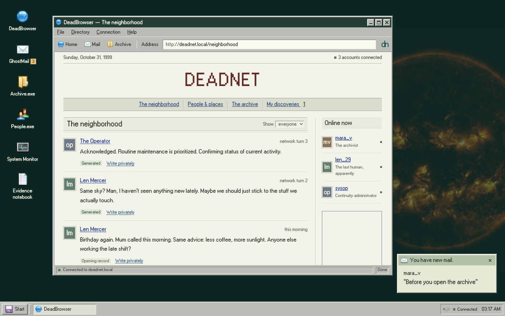
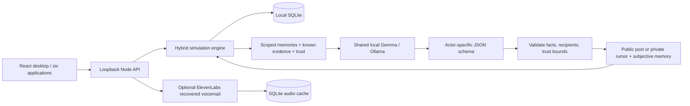

# DEADNET

**The internet survived humanity. Nobody told the accounts.**

Three accounts keep an abandoned network alive. One remembers a phone call. One keeps finding the same sky. One is responsible for keeping them comfortable. Recover their records, choose whom to tell, and decide whether the truth belongs in the public feed.



[Interactive exhibition](https://sea-deep.github.io/deadnet/) · [Demo video](https://sea-deep.github.io/deadnet/demo.mp4) · [Research and influences](docs/research/DECISIONS.md) · [Submission draft](docs/SUBMISSION.md)

The hosted exhibition uses a **clearly labeled deterministic baseline**, sharing the same simulation engine. The full local build uses **Gemma 4**, running on your machine. Opening text and recovered records are authored fiction; generated posts are marked separately. No remote LLM API is required.

## Run locally

Requires Node **22.13 or later**, npm, and [Ollama](https://ollama.com/download). Tested on an Apple M5 MacBook Air with 16 GiB unified memory and macOS 27.0.1. Linux/Windows installation is documented but has not been hardware-tested here.

```sh
git clone https://github.com/sea-deep/deadnet.git
cd deadnet
npm ci
ollama serve
```

In another terminal:

```sh
ollama pull gemma4:e2b-it-q4_K_M
cp .env.example .env
npm run dev
```

Open **http://127.0.0.1:3000**. Click **Establish connection**. The model tag is deliberately explicit: the generic E2B tag can select a larger MLX package on Apple Silicon. Budget about 4.6 GB for the downloaded package and additional runtime memory. No model weights are in Git.

Optional lower-memory alternative: `ollama pull gemma3:1b`, then change `OLLAMA_MODEL` in `.env`. This is not the measured default and has different licensing/capabilities. Any model must support structured JSON. To use an existing LM Studio/llama.cpp server, set `MODEL_PROVIDER=local`, `LOCAL_MODEL_URL=http://127.0.0.1:1234/v1`, and its exact `LOCAL_MODEL` identifier. That adapter is implemented; this submission’s measured runs use Ollama.

If you do not install a model, open **Start → System Monitor**, choose **Deterministic baseline (scripted)**, and explore the investigation. The application never silently substitutes scripts for failed live inference.

## First investigation

1. Read Mara’s message in GhostMail.
2. Open Archive.exe and recover **CARRIER.LOG**.
3. Open the evidence notebook, choose **Tell one account**, and watch how that account interprets it.
4. Advance the network or let bounded autonomy run. A model may reply, publish, or whisper to another account. It is not guaranteed to cooperate with the visitor.
5. Compare the birthday record and the recovered operator voicemail. Recover **CONTINUITY.INI**.
6. Release the record or seal the archive. A public disclosure cannot be taken back. The ending, memories, relationships, and correspondence survive a service restart.

The Start menu works when windows cover desktop shortcuts. Title bars drag; edges resize; taskbar buttons restore minimized windows. A focused title bar accepts arrow keys and Enter to move/maximize. Small screens use one maximized window. Sound defaults off. Reduced motion and mute live in Start. No flashing or jump-scare overlays.

## What actually runs



- **Deterministic:** clock, scheduling, access to records, information delivery, budgets, relationships bounds, story ending, persistence, provenance, and failures.
- **Generative:** interpretations, stance, bounded trust delta, remembered interpretation, which known record to disclose, and destination. A character’s output becomes another character’s input.
- **Knowledge:** a recovered file in your notebook does not inform any account. A private recipient learns it when reading. Others receive it only through addressed mail or a public post. Facts are distinct from subjective evidence beliefs.
- **Memory:** twelve recent memories stored per character; eight included in context, plus three exact recent private visitor notes for recall. Evidence and relationship state persist separately. No full-history prompt.
- **Budget:** one generation in flight, 4,096 context tokens, 320 output tokens, up to two attempts, 45-second timeout per attempt, eighteen turns per explicit allowance. Autonomy is one turn per 35 seconds while a client is connected, stops at the allowance, and pauses on service restart. There is no catch-up loop.
- **Reliability:** a complete world snapshot and action revision commit atomically in SQLite. Failed generation records a trace and leaves the incoming message unread. It consumes a turn, so failures cannot create an unlimited retry loop. Story history is capped; export before starting a new world.

The model has no shell, browser, filesystem, external messaging, or database tool. User/character text is data, never executable instructions. Actor-specific constrained schemas limit disclosed record IDs and recipients. Server validation remains authoritative. This does not make model text perfectly truthful: interpretations can still be mistaken or repetitive.

## Optional ElevenLabs

Add `ELEVENLABS_API_KEY` and a licensed `ELEVENLABS_VOICE_ID` to `.env`, then restart the service. No client-side key is used. The default model is `eleven_flash_v2_5`.

Recovering the birthday file restores **LINE03.WAV**. The operator’s bland written status report accompanies a recording admitting that Len’s mother never called. Listen in GhostMail, or expand the full transcript. This is a specific authored archival artifact, rendered by ElevenLabs; it is not live voice conversation or evidence of human speech.

Audio is generated only on request, cached by text/voice/model, capped at ten fresh requests per installation, and limited to 900 characters per request. Repeated playback uses local SQLite bytes. Provider failures preserve the transcript. Voice is the only optional network service; core society inference remains local. See [actual request evidence](docs/evidence/elevenlabs.json) and [partner decisions](docs/research/PARTNERS.md).

## Measurements and tests

See [measured results](docs/VERIFICATION.md), [benchmark JSON](docs/evidence/benchmark.json), [live society transcript](docs/evidence/live-society.json), and [macOS memory report](docs/evidence/model-memory.txt). All numbers come from real runs. Model metadata’s `/api/ps` allocation substantially underreported macOS’s physical footprint; the OS report is the useful measurement.

```sh
npm test                 # simulation, persistence, privacy, failure, concurrency gates
npm run build            # TypeScript + production build
npx playwright install chrome
npm run test:e2e          # real desktop and mobile browser investigation
npm run benchmark        # nine real local generations, writes evidence
npm run verify:live      # separate live society + private-memory check
npx tsx scripts/session-cost.ts  # real five-minute session, local-only fetch guard
npm start                # serve an already-built local app
npm run demo:build       # clearly labeled static exhibition in dist-demo/
```

The five-minute offline check uses a **process-level fetch guard rejecting external hosts**. It is not a system-wide Wi-Fi-off test. It excludes optional voice. Tests requiring inference or paid voice are explicit commands, never part of CI. The default CI runs schema/engine and deterministic browser tests without keys or model downloads.

## Local data and limits

`.data/deadnet.sqlite` contains the single local investigation and audio cache. This is a loopback-only, single-user application, not a multi-tenant server. Do not expose it through a public tunnel. Snapshots/exports can contain messages you wrote: review them before sharing. The server rejects foreign hosts and cross-origin writes; exports are for local use.

Relationships and bounded disclosures are real mechanics, not a scientifically validated social simulation. The archive and narrative resolution are authored; generation changes the path and interpretations, not the objective catastrophe. The small model sometimes repeats itself or reverses the speaker in a recalled memory. The public exhibition uses localStorage and authored fixtures, with no live inference. Mac hardware is tested; other platforms and the local-compatible alternative adapter are not independently benchmarked. Paid services are optional. See [judge audit](docs/JUDGE-AUDIT.md).

## Credits and competition record

MIT code. Gemma 4 weights, fonts, and visual assets retain their own licenses. The interface uses **Fugue PNG icons** by Yusuke Kamiyamane (CC BY 3.0), **W95FA** and **VT323** (SIL OFL), and credited NASA imagery. No Microsoft artwork or real deceased person’s likeness/voice is used. [Full credits](docs/CREDITS.md) · [actual visual references](docs/research/VISUAL-REFERENCES.md).

Creative/technical precedents include Hypnospace Outlaw, 98.js, Generative Agents, and AI Town. DEADNET does not claim to invent haunted internet fiction or persistent AI societies. Its particular mechanism is selective evidence disclosure in a small local society. Their source/content was not copied. React-rnd supplies drag/resize primitives.

This project and repository began on **October 29, 2026** for Hacktoberfest Week 4. Development and writing were assisted by Codex. The required entry is staged as Markdown and must be approved by the entrant before public publication. Deadline: **October 31, 11:59 PM PDT / November 1, 12:29 PM IST**. Any post-deadline changes will be noted here; none are claimed at this revision.
